#PERSONAL PORTFOLIO WEBSITE

This is a **Personal Portfolio Website** built using **React**. The website showcases my projects, skills, and experience in a clean and professional layout. It is designed to be fully responsive and optimized for both desktop and mobile devices and built with impeccable attention to detail.

---

## Table of Contents
1. [Introduction](#introduction)
2. [Features](#features)
3. [Technologies Used](#technologies-used)
4. [React Reusable Components](#react-reusable-components)
5. [Setup Instructions](#setup-instructions)
6. [Folder Structure](#folder-structure)
7. [Screenshots](#screenshots)
8. [Mobile Responsiveness](#mobile-responsiveness)
9. [License](#license)

---

## Introduction

This portfolio website is a platform to showcase the developer's skills, projects, and experience. It is built with **React**, leveraging reusable components to ensure scalability and maintainability. The website is designed to leave a lasting impression on potential employers and collaborators.

---

## Features

- **Developer Portfolio**: Hosts an interactive Developer portfolio build with React with easy updates to Resume
- **5 in 1 Website**: website hosts a separate photography webpage and a responsive home page apart from dev-portfolio.
- **Responsive Design**: Optimized for both desktop and mobile devices.
- **Reusable Components**: Built with React reusable components to ensure modularity and scalability.
- **Modern UI/UX**: Clean and professional design with a focus on user experience.

---

## Technologies Used

- **React**: Frontend framework for building reusable UI components.
- **CSS**: Styling for the website.
- **JavaScript**: Logic and interactivity.
- **Node.js**: Backend (if applicable).
- **npm**: Package manager for managing dependencies.

---

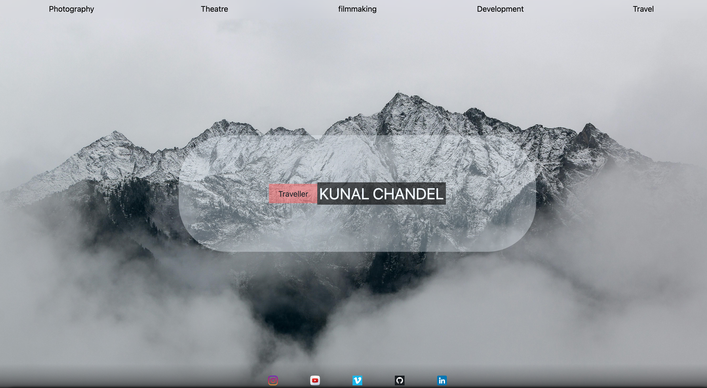  
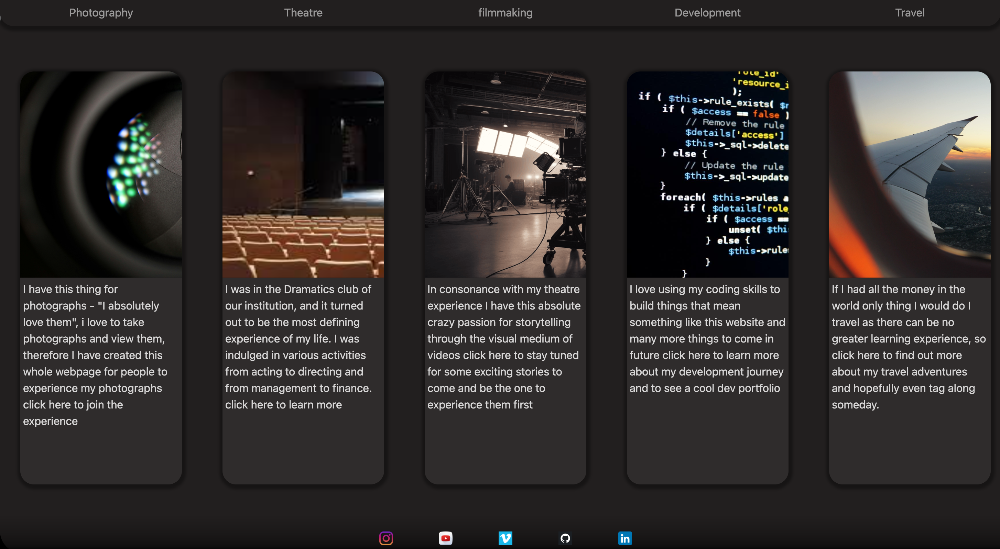

## React Reusable Components

The website is built using React reusable components to ensure modularity and maintainability example:

1. **Projects Component**:
   - The `Projects` component dynamically renders a list of projects using data from a `data.js` file.
   - Each project is displayed as a card with its title, description, technologies used, and a GitHub link.
   - Example:
     ```javascript
     const prj = data.proj.map((obj) => {
       return (
         <div className="single-xp" key={obj.id}>
           <h1>{obj.Title}</h1>
           <p>{obj.description}</p>
           <p>Tech: {obj.tech}</p>
           <p>
             <a href={obj.link} target="_blank" rel="noopener noreferrer">
               Github Link
             </a>
           </p>
         </div>
       );
     });
     ```
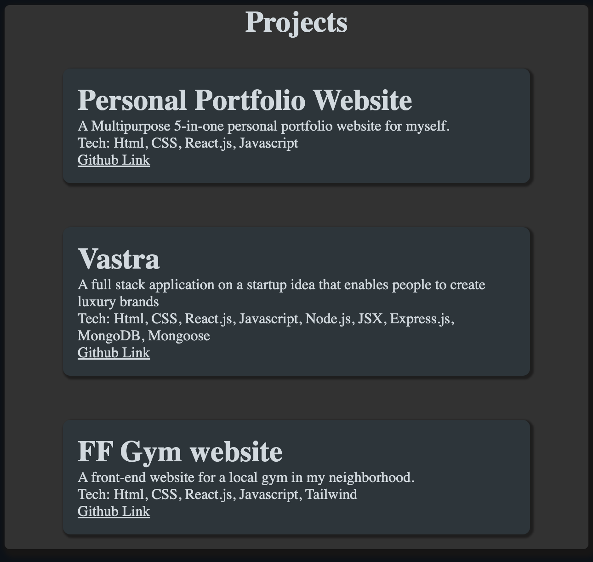

## THEMES FOR DEV-PORTFOLIO

Various themes have been provided to view the dev-portfolio - implemented using React Component base Architecture. User can select one of the themes and it shall apply instantly

**Theme Menu**  
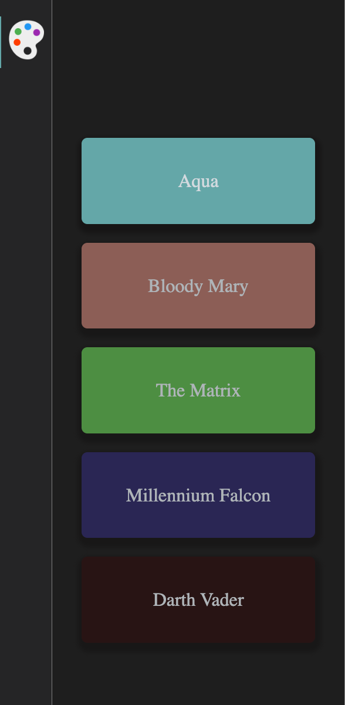

**Standout Themes**  

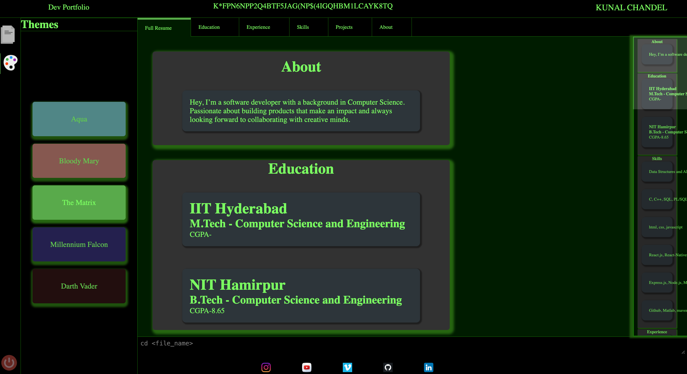  
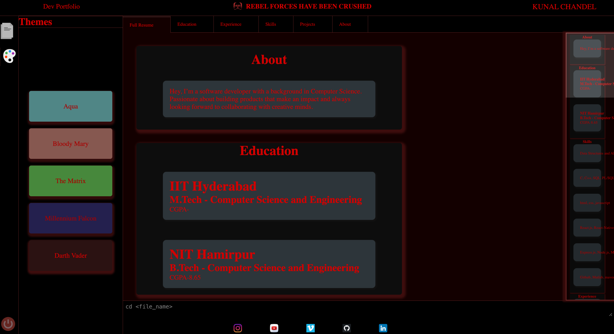

## RESPONSIVE SCROLL BAR

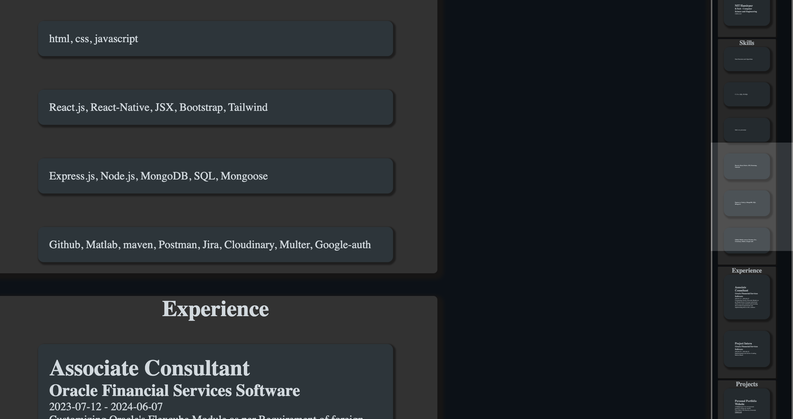


## DEDICATED PHOTO GALLERY IMPLEMENTATION

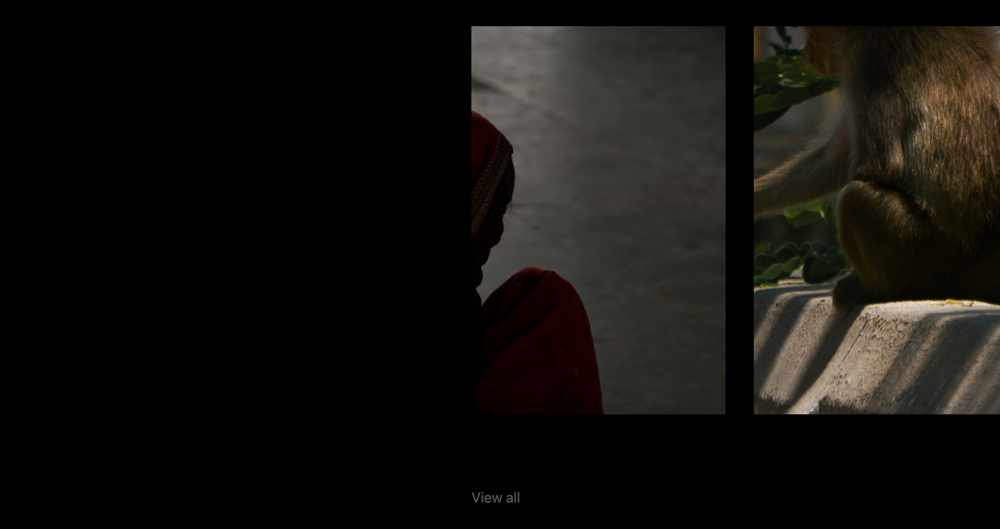  
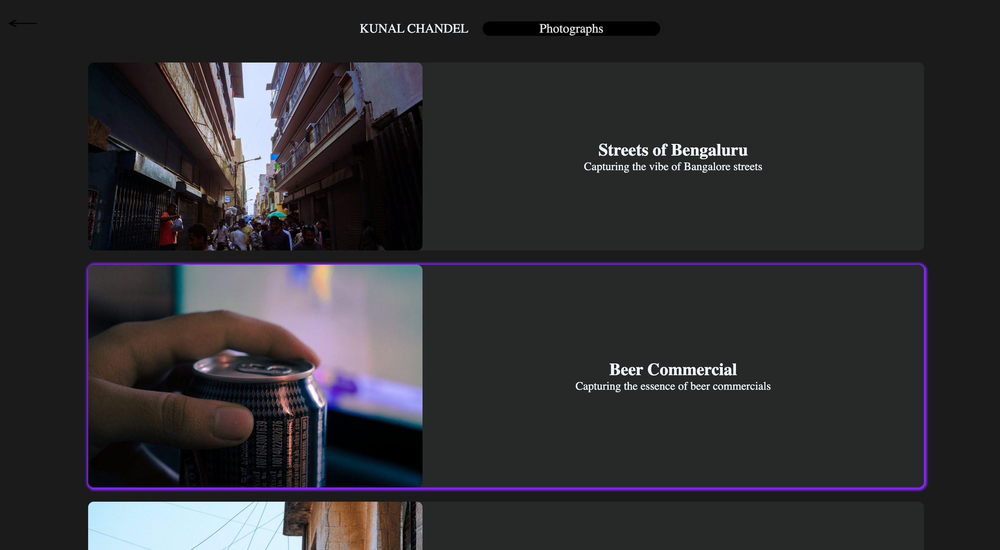
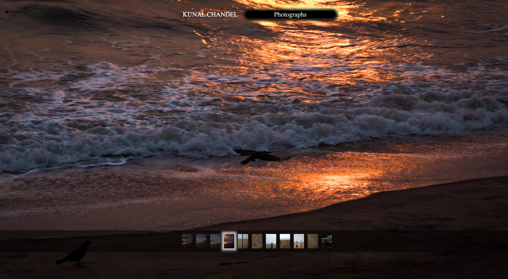  
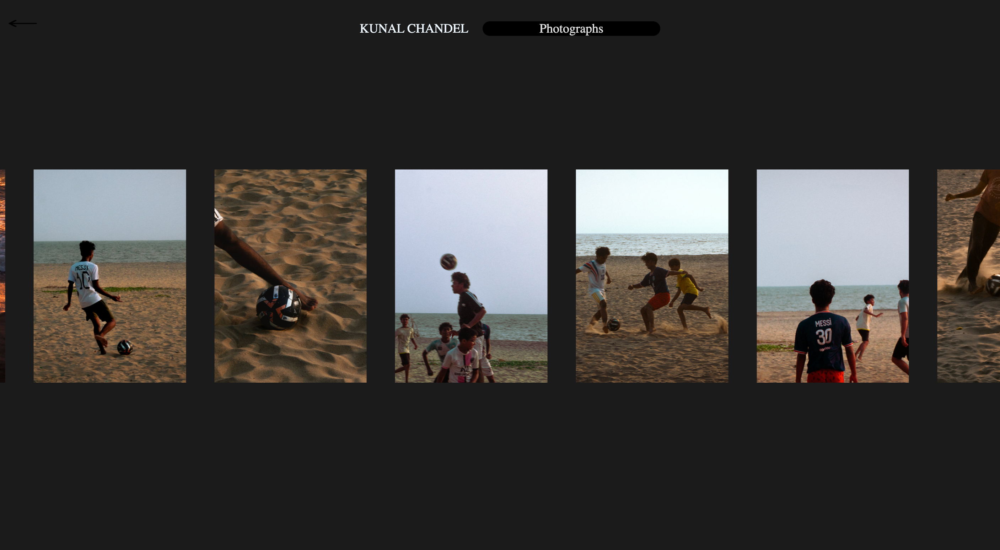

## MOBILE FRIENDLY AND ADAPTIVE DESIGN

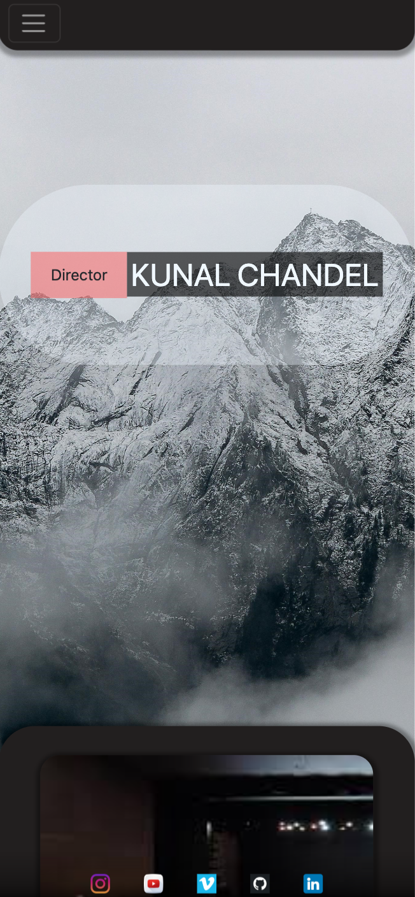
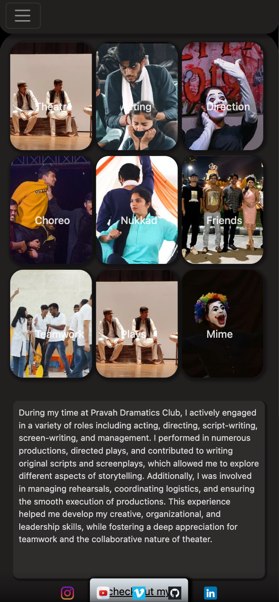
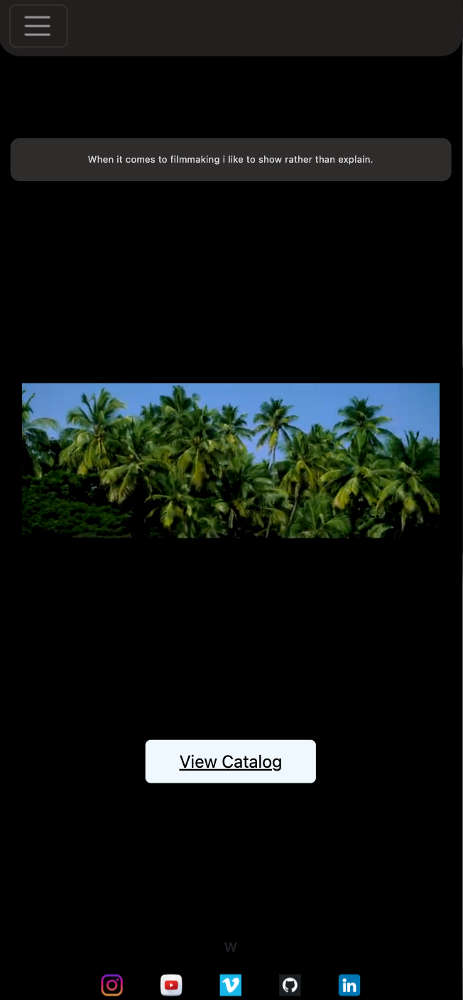
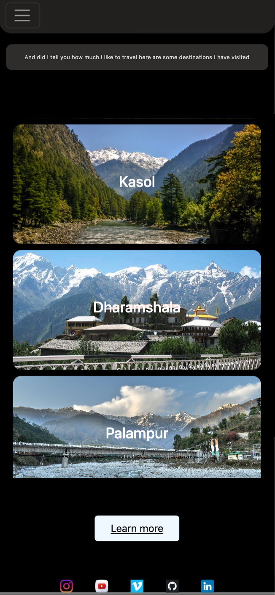
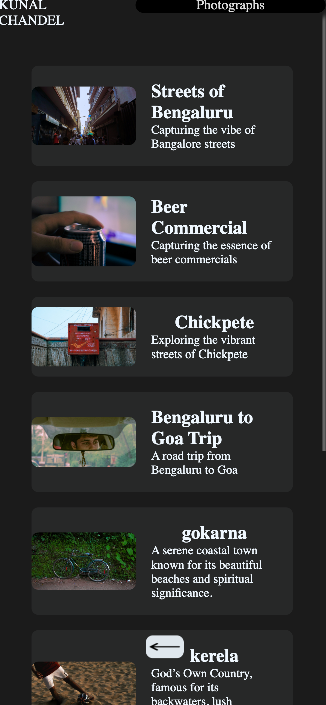
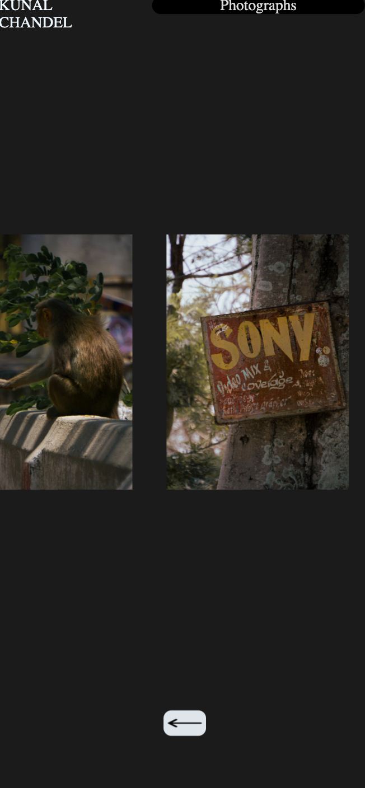
---
